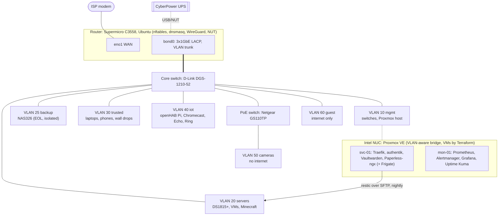

# homelab

[](https://github.com/mateis1309/homelab/actions/workflows/ci.yml)
[](LICENSE)

**My home network and servers, written as code.** A small office in miniature: segmented network, zone firewall,
VPN, single sign-on, password manager, document archive, monitoring with alerts, and backups that are
restore-tested every week. Everything runs on second-hand hardware and free software.

It is also where I try out what I recommend to small organisations before recommending it.

- **One source of truth.** VLANs, subnets, hosts and VM sizes live in a single file,
  [`lab.yml`](ansible/inventory/group_vars/all/lab.yml). Ansible renders the router, DNS/DHCP and firewall from it,
  and Terraform reads the *same file* to create the VMs.
- **Changes that can't lock me out.** Firewall and interface changes are applied behind a dead man's switch: a systemd
  timer rolls them back unless Ansible can open a *new* SSH connection afterwards ([`safe_apply`](ansible/roles/safe_apply)).
- **Backups that are proven, not assumed.** Nightly restic snapshots with consistent database dumps; a weekly job restores
  the latest snapshot, checks the files and opens every database. Both report to Prometheus, and a stale or failed run
  alerts on Telegram. CI runs the whole backup → restore → deliberate-failure cycle on every push.
- **Tested with the real tools.** CI renders every template with the real inventory and checks the output with
  `nft -c`, `dnsmasq --test`, `netplan generate`, `docker compose config`, `promtool`, `amtool` and `shellcheck`.
- **Built on [Temper](https://github.com/mateis1309/temper).** My hardening pipeline (key-only SSH, UFW, fail2ban,
  unattended upgrades, sysctl, audit) is pulled in as a submodule and applied to every Linux host.

## Architecture



| Zone | VLAN | Can reach |
|---|---|---|
| mgmt | 10 | everything (admin) |
| servers | 20 | internet; specific ports in other zones (metrics, NAS replication, NVR → cameras) |
| backup | 25 | nothing. Only the primary NAS can reach it (rsync) |
| trusted | 30 | internet; web apps, NAS shares, openHAB, cast devices, Minecraft |
| iot | 40 | internet only |
| cameras | 50 | nothing, not even the internet. Only the NVR can reach them |
| guest | 60 | internet only |
| vpn (WireGuard) | – | same as mgmt |

Full policy, IP plan and switch port map: [docs/network.md](docs/network.md).

## Hardware

| Device | Role |
|---|---|
| Supermicro SYS-A2SDI-4C4L-FIO (Atom C3558, 4× 1GbE) | Router/firewall: Ubuntu, nftables, dnsmasq, chrony, WireGuard, NUT server |
| D-Link DGS-1210-52 | Core switch: 802.1Q VLANs, LACP to the router |
| Netgear GS110TP | PoE for the IP cameras, VLAN 50 only |
| Intel NUC | Proxmox VE 9: VMs `svc-01` and `mon-01` |
| Synology DS1815+ (8-bay, 32 TB) | Primary storage, restic repository, Hyper Backup source |
| Zyxel NAS326 | Second copy of the NAS data (isolated, end-of-life) |
| Raspberry Pi 4 | openHAB (home automation) |
| MacBook Pro (clamshell) | Minecraft server |
| CyberPower UPS | Graceful shutdown of the NUC and NAS through NUT |

Known risks of the second-hand gear (Atom C2000 defect, NAS326 end of life) and how they're handled: [docs/hardware.md](docs/hardware.md).

## Status

The code is complete and CI-tested; the rollout to the hardware happens in this order. The last column is ticked as each step goes live.

| Step | What | Code | Live |
|---|---|---|---|
| 1 | VLANs on the switches, router netplan + nftables cut-over | ✅ | ☐ |
| 2 | dnsmasq/chrony/mDNS, WireGuard (OpenVPN retired) | ✅ | ☐ |
| 3 | UPS: NUT server on router, NUC and DS1815+ as clients | ✅ | ☐ |
| 4 | Proxmox post-install, cloud-init template, Terraform VMs | ✅ | ☐ |
| 5 | svc-01: Traefik, authentik, Vaultwarden, Paperless-ngx | ✅ | ☐ |
| 6 | Backups: restic → DS1815+, Hyper Backup → NAS326 + off-site | ✅ | ☐ |
| 7 | mon-01: Prometheus, Alertmanager → Telegram, Grafana, Uptime Kuma | ✅ | ☐ |
| 8 | Frigate for the PoE cameras (after re-terminating the cabling) | ✅ | ☐ |

Next: [docs/roadmap.md](docs/roadmap.md).

## Quick start

```bash
git clone --recurse-submodules https://github.com/mateis1309/homelab.git && cd homelab
pip install -r requirements-dev.txt && make deps

cp ansible/vault.example.yml ansible/inventory/group_vars/all/vault.yml
$EDITOR ansible/inventory/group_vars/all/vault.yml && ansible-vault encrypt ansible/inventory/group_vars/all/vault.yml

make test          # render + validate everything locally; no hardware needed
make router        # then: hypervisor, vms, services, audit (or `make deploy`)
```

First-time rollout, including the one step that has to be done at the console: [docs/runbooks/bootstrap.md](docs/runbooks/bootstrap.md).

## Repository layout

```text
ansible/inventory/group_vars/all/lab.yml   the network model (zones, hosts, VM sizes), read by Ansible AND Terraform
ansible/inventory/group_vars/*.yml         per-group settings: firewall rules, routes, backup paths
ansible/roles/                             router_network, router_firewall, router_services, wireguard, safe_apply,
                                           nut_server, nut_client, node_exporter, pve_host, docker_host, stacks,
                                           restic_backup
ansible/roles/stacks/templates/<stack>/    compose stacks: traefik, authentik, vaultwarden, paperless, frigate, monitoring
ansible/tests/                             render.yml (CI render), backup_e2e.yml (backup/restore end-to-end)
terraform/                                 Proxmox VMs (bpg/proxmox), generated from lab.yml
vendor/temper/                             hardening + audit roles (git submodule)
tests/validate.sh                          checks rendered output with nft, dnsmasq, netplan, compose, promtool...
docs/                                      network, backup, hardware, decisions (ADRs), runbooks, roadmap
```

## Documentation

- [Network](docs/network.md): zones, IP plan, firewall policy, switch ports, Wi-Fi, DNS
- [Backups](docs/backup.md): 3-2-1 layout, schedules, restore testing, NAS setup
- [Hardware](docs/hardware.md): inventory and known risks
- Decisions: [router as code](docs/decisions/0001-router-as-code.md) ·
  [WireGuard](docs/decisions/0002-wireguard-over-openvpn.md) ·
  [Proxmox + Terraform](docs/decisions/0003-proxmox-and-terraform.md) ·
  [authentik SSO](docs/decisions/0004-single-sign-on.md) ·
  [restic + 3-2-1](docs/decisions/0005-backups.md) ·
  [monitoring on its own VM](docs/decisions/0006-monitoring-placement.md) ·
  [no Docker socket in Traefik](docs/decisions/0007-traefik-file-provider.md)
- Runbooks: [bootstrap](docs/runbooks/bootstrap.md) · [restore](docs/runbooks/restore.md) ·
  [power outage](docs/runbooks/power-outage.md) · [add a VPN peer](docs/runbooks/add-wireguard-peer.md) ·
  [add a service](docs/runbooks/add-service.md)

## License

[MIT](LICENSE)
